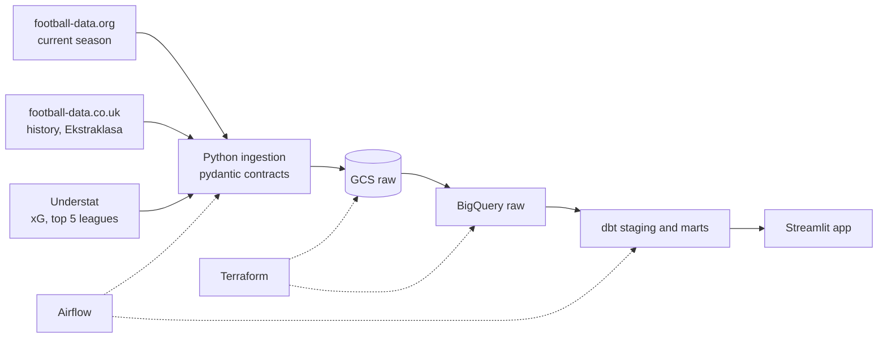

# Football Analytics Pipeline

A batch ELT pipeline that collects match results and expected goals (xG) for many European
leagues, models them as a star schema in BigQuery and serves the analysis through an
interactive Streamlit app. It answers one question across leagues: **which teams and players
outperform or underperform their xG?** There is a special focus on the Polish Ekstraklasa.

> Work in progress. The project is built in phases, starting with a thin end-to-end slice.

## Architecture



## Stack

| Layer | Technology |
| :--- | :--- |
| Ingestion | Python, requests, pydantic |
| Raw storage | Google Cloud Storage |
| Warehouse | BigQuery |
| Transformations and data tests | dbt Core |
| Orchestration | Apache Airflow 3 |
| Infrastructure | Terraform |
| CI | GitHub Actions |
| Code quality | uv, ruff, pyright, pytest, pre-commit |
| Analytics | Streamlit, pandas, plotly |

## Data sources and licensing

Only code is published. Raw data stays in a private cloud bucket and never enters this
repository. Free xG data that may be redistributed does not exist for the Ekstraklasa, so
the public app covers it with results-based models (Elo, Poisson), and xG for the top five
leagues comes from Understat. The code is [MIT-licensed](LICENSE); the data belongs to its
sources and is not covered by that license.

## Development

You need [uv](https://docs.astral.sh/uv/), the
[gcloud CLI](https://docs.cloud.google.com/sdk/docs/install), a free
[football-data.org](https://www.football-data.org/client/register) API token and a Google
Cloud project of your own: billing enabled, a GCS bucket and a BigQuery dataset `raw`, both
in `us-central1`. Code authenticates with Application Default Credentials, so no service
account keys are needed.

```bash
uv sync
uv run pre-commit install
cp .env.example .env    # then fill in the values
gcloud auth application-default login
uv run --env-file .env dbt deps
```

Run the pipeline for a day. The run date decides where the data lands, so a rerun of the
same day replaces it. Finished seasons of football-data.co.uk are fetched only once:

```bash
uv run ingest extract football-data --run-date 2026-10-25    # every competition, this season
uv run ingest load football-data --run-date 2026-10-25
uv run ingest extract football-data-co-uk --history-from 2017 --run-date 2026-10-25
uv run ingest load football-data-co-uk --run-date 2026-10-25
uv run --env-file .env dbt build
uv run --env-file .env streamlit run app/streamlit_app.py
```

Run the checks, as CI does:

```bash
uv run pre-commit run --all-files
uv run pyright
uv run pytest
```
