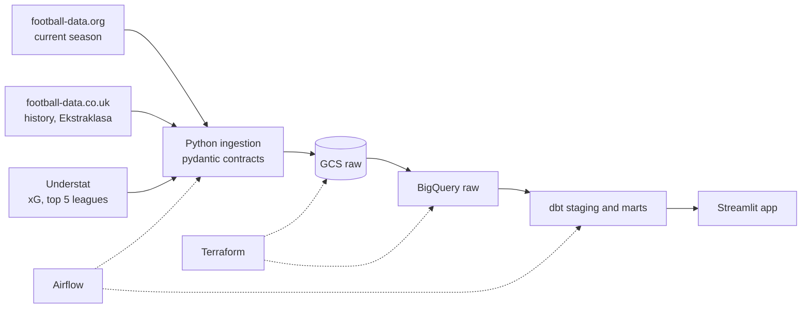

# Football Analytics Pipeline

A batch ELT pipeline that collects match results and expected goals (xG) for many European
leagues, models them as a star schema in BigQuery and serves the analysis through an
interactive Streamlit app. It answers one question across leagues: **which teams and players
outperform or underperform their xG?** There is a special focus on the Polish Ekstraklasa.

> Work in progress. The project is built in phases, starting with a thin end-to-end slice.

## Architecture



## Stack

| Layer | Technology |
| :--- | :--- |
| Ingestion | Python, requests, pydantic |
| Raw storage | Google Cloud Storage |
| Warehouse | BigQuery |
| Transformations and data tests | dbt Core |
| Orchestration | Apache Airflow 3 |
| Infrastructure | Terraform |
| CI | GitHub Actions |
| Code quality | uv, ruff, pyright, pytest, pre-commit |
| Analytics | Streamlit, pandas, plotly |

## Data sources and licensing

Only code is published. Raw data stays in a private cloud bucket and never enters this
repository. Free xG data that may be redistributed does not exist for the Ekstraklasa, so
the public app covers it with results-based models (Elo, Poisson), and xG for the top five
leagues comes from Understat.

## Development

```bash
uv sync
uv run pre-commit install
uv run pre-commit run --all-files
```
