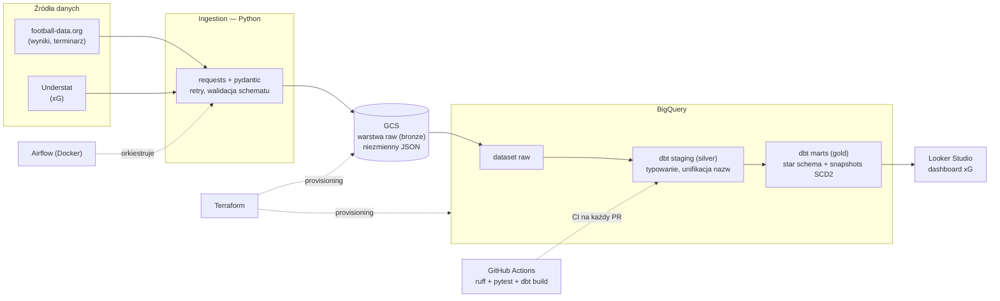

# Football Analytics Pipeline — plan projektu

> Dokument roboczy projektu portfolio z data engineeringu. Służy dwóm celom:
> **nauka** (każda faza ma sekcję „czego się uczysz") i **pokazanie umiejętności**
> rekruterom. Jest też źródłem prawdy dla agentów AI pracujących nad projektem —
> patrz sekcja [Instrukcje dla agentów](#instrukcje-dla-agentów).

**Status:** planowanie (2026-07-15) · **Autor:** Szymon · **Repo:** `~/my_projects/sport_analytics`

---

## 1. Cel i teza projektu

Tygodniowy potok batch ELT, który pobiera wyniki meczów i statystyki zaawansowane
(xG) z publicznych źródeł, ładuje je do hurtowni, modeluje w gwiazdę i serwuje
dashboard odpowiadający na pytanie analityczne: **które drużyny i którzy zawodnicy
przewyższają / zawodzą względem swojego xG?**

Projekt ma demonstrować kompletny warsztat data engineera, a nie maksymalną liczbę
technologii. Kluczowa decyzja architektoniczna: **jeden silnik transformacji
(dbt + BigQuery), nie dwa**. Oryginalny pomysł (Spark + Delta Lake *oraz* dbt +
hurtownia równolegle) dublował compute i storage — w portfolio wygląda to na
niezrozumienie architektury. Spark wraca jako świadoma, opcjonalna faza 8 na
danych eventowych, gdzie ma choć trochę uzasadnienia.

## 2. Architektura



Wzorzec: **ELT** — surowe dane lądują w hurtowni niemal bez zmian, transformacje
robi SQL (dbt) już wewnątrz BigQuery. To dziś dominujący układ w ogłoszeniach
o pracę i pozwala trzymać całą logikę biznesową w jednym, testowalnym miejscu.

## 3. Stack technologiczny (z uzasadnieniami)

| Warstwa | Wybór | Dlaczego to, a nie alternatywa |
| :--- | :--- | :--- |
| Orkiestracja | **Apache Airflow 3** (docker-compose) | Najczęściej wymagany orkiestrator w ogłoszeniach. Prefect/Dagster są przyjemniejsze, ale rzadsze na rynku. |
| Ingestion | **Python** (requests + pydantic) | Pydantic waliduje odpowiedzi API na wejściu — zmiana schematu źródła wybucha głośno w ingestion, nie cicho w gold. |
| Data lake (raw) | **GCS** | Darmowe 5 GB (region US), natywna integracja z BigQuery. |
| Hurtownia | **BigQuery** | Sandbox darmowy bezterminowo (10 GB storage, 1 TB zapytań/mies.). Snowflake odpada: trial wygasa po 30 dniach, a projekt ma żyć miesiącami. |
| Transformacje + testy | **dbt Core** | Standard branżowy analytics engineeringu: modele SQL, testy jakości, dokumentacja lineage, snapshots SCD2. |
| IaC | **Terraform** | Bucket, datasety BQ, service account — realistyczny, mały zakres. |
| CI/CD | **GitHub Actions** | Lint + testy + `dbt build` na każdy PR. Największa pojedyncza rzecz odróżniająca projekt „firmowy" od tutorialowego. |
| Jakość kodu | **uv + ruff + pytest + pre-commit** | Współczesny standard tooling'u pythonowego. |
| Wizualizacja | **Looker Studio** | Darmowe, natywne połączenie z BigQuery. |
| (Faza 8, opcja) | PySpark + Delta Lake | Tylko na danych eventowych StatsBomb i z jawnym dopiskiem w README, że to wybór edukacyjny. |

## 4. Źródła danych

Limity zweryfikowane 2026-07-15 — to one wymusiły zmiany względem pierwotnego planu:

| Źródło | Dane | Limit / ryzyko | Rola w projekcie |
| :--- | :--- | :--- | :--- |
| **football-data.org** | wyniki, terminarz, tabele, składy (top ligi, bieżące sezony) | free: ~10 req/min | **Główne źródło meczów** |
| **Understat** | xG meczowe i per zawodnik (JSON osadzony w HTML) | brak oficjalnego API; scraping lekki i stabilny | **Źródło xG** — drugie źródło do fuzzy matchingu |
| **StatsBomb Open Data** | pełne dane eventowe z xG (JSON na GitHubie) | brak — darmowe i legalne | Faza 8 (Spark) |
| API-Football | wyniki, statystyki drużynowe | free: 100 req/dzień, ograniczona historia sezonów | Opcjonalny zamiennik football-data.org |
| ~~FBref~~ | statystyki zaawansowane | **twardy limit 10 req/min, bany IP do 24 h**, ToS zabrania redystrybucji (dane Opty); tabele ukryte w komentarzach HTML | **Odrzucone jako filar** — zbyt kruche i prawnie szare jak na publiczne repo |

Wyzwanie inżynieryjne z oryginalnego planu **zostaje**: dwa źródła inaczej nazywają
kluby i zawodników („Man Utd" vs „Manchester United"). Rozwiązanie: `rapidfuzz`
do wstępnego dopasowania + ręcznie kuratorowana tabela mapowań jako **dbt seed**
+ test dbt, który failuje, gdy pojawi się niezmapowana nazwa.

## 5. Warstwy danych i konwencje

| Warstwa | Gdzie | Zawartość i zasady |
| :--- | :--- | :--- |
| **Bronze / raw** | GCS | Surowe odpowiedzi API, niezmienne (append-only). Ścieżka: `raw/source=<źródło>/season=<rrrr>/ingest_date=<rrrr-mm-dd>/<plik>.json`. Partycjonowanie po źródle i sezonie — płaska struktura samymi datami mści się przy wielu źródłach. |
| **Silver / staging** | BigQuery, modele `stg_*` w dbt | Typowanie (`DATE`, `FLOAT64`), rozpakowanie zagnieżdżonego JSON-a, standaryzacja nazw przez seed mapowań. 1 model = 1 obiekt źródłowy. |
| **Gold / marts** | BigQuery, modele `dim_*` / `fct_*` w dbt | Star schema, modele inkrementalne ze strategią `merge` (to załatwia idempotentność), logika biznesowa. |

**Idempotentność i backfill** — zasada przekrojowa: każdy run jest parametryzowany
`data_interval` z Airflow (nie datą „dzisiejszą"!), pliki w raw są deterministycznie
nazwane per interwał, a zapis do gold idzie przez `MERGE`. Ponowne uruchomienie
tego samego okna daje identyczny stan — zero duplikatów. Backfill = `airflow dags
backfill` po starych interwałach, bez żadnego specjalnego kodu.

## 6. Model danych (star schema)

- `dim_teams` — klub: klucz zastępczy, nazwa kanoniczna, liga.
- `dim_players` — zawodnik, **SCD2 przez dbt snapshot**: historia przynależności
  klubowej (transfery!). To mocniejszy sygnał dla rekrutera niż cały Spark.
- `dim_date` — standardowy wymiar daty (sezon, kolejka, dzień tygodnia).
- `fct_matches` — grain: 1 mecz. Gole, xG obu stron, punkty.
- `fct_player_match_stats` — grain: zawodnik × mecz. Minuty, gole, asysty, xG, xA.
- seed `team_name_mapping.csv` (+ analogiczny dla zawodników).

**Testy dbt:** `unique` + `not_null` na kluczach, `relationships` fakty→wymiary,
testy własne (gole ≥ 0, xG ≥ 0, suma minut zawodników ≤ 11 × 90 + doliczony czas),
test na niezmapowane nazwy drużyn.

## 7. Fazy budowy

Najczęstszy błąd w takich projektach to szlifowanie warstwy bronze tygodniami.
Dlatego kolejność jest odwrotna: najpierw **cienki pion end-to-end**, potem
pogłębianie. Każda faza = osobna gałąź i PR z sensownym opisem — historia repo
sama w sobie jest częścią portfolio.

### Faza 0 — fundamenty repo
`git init`, struktura katalogów (sekcja 9), `uv init` + `pyproject.toml`, ruff,
pre-commit, `.env.example` (nigdy `.env` do repo), pierwsze README.
**Done gdy:** `pre-commit run --all-files` przechodzi na czystym klonie.
**Czego się uczysz:** higiena projektu pythonowego, jak wygląda repo „firmowe".

### Faza 1 — cienki pion (MVP, wszystko ręcznie)
Jeden skrypt: football-data.org → JSON na GCS → `bq load` do datasetu raw →
jeden model dbt (`stg_matches` + prosty `fct_matches`) → jeden wykres w Looker
Studio. Zasoby GCP na razie wyklikane ręcznie — Terraform przyjdzie w fazie 6.
**Done gdy:** wykres w Looker Studio pokazuje dane prawdziwego meczu.
**Czego się uczysz:** cały przepływ ELT na krzyż, konsola GCP, podstawy dbt.
*Uwaga (gotcha):* w sandboksie BigQuery tabele domyślnie wygasają po 60 dniach —
docelowo podepnij konto rozliczeniowe (free tier 10 GB / 1 TB dalej obowiązuje).

### Faza 2 — ingestion na poważnie
Modele pydantic dla odpowiedzi API, retry z backoffem, logowanie strukturalne,
deterministyczne ścieżki zapisu per interwał, klient GCS. Testy pytest dla
parserów (fixture'y z prawdziwych odpowiedzi API zapisanych w `tests/fixtures/`).
**Done gdy:** pytest przechodzi; podwójne uruchomienie nie tworzy duplikatów w raw.
**Czego się uczysz:** kontrakty danych, defensywne pobieranie, testowanie I/O.

### Faza 3 — dbt na poważnie
Rozdzielenie staging/marts, modele inkrementalne (`merge`), pełny zestaw testów,
`dim_date`, `dbt docs generate` (screenshot lineage do README).
**Done gdy:** `dbt build` przechodzi w 100 % łącznie z testami.
**Czego się uczysz:** modelowanie wymiarowe, testy jakości danych, incremental
materializations — rdzeń pracy analytics engineera.

### Faza 4 — drugie źródło i fuzzy matching
Ingestion Understat (xG), `rapidfuzz` do propozycji dopasowań, seed z mapowaniem,
test dbt failujący na niezmapowanych nazwach, `fct_player_match_stats`.
**Done gdy:** dashboard pokazuje xG vs gole per zawodnik z połączonych źródeł.
**Czego się uczysz:** integracja niezgodnych źródeł — najbardziej „prawdziwy"
problem DE w całym projekcie.

### Faza 5 — orkiestracja (Airflow)
Airflow 3 przez oficjalny docker-compose. DAG tygodniowy (wtorek rano — kolejka
rozciąga się od piątku do poniedziałku, więc „po kolejce" to śliski trigger):
ingestion → load → `dbt build`, parametryzowany `data_interval`, `catchup` do
backfillu historii sezonu, alert na Discorda (webhook w `on_failure_callback`).
**Done gdy:** `airflow dags backfill` odtwarza cały sezon bez duplikatów.
**Czego się uczysz:** DAG-i, harmonogramy, idempotentny backfill, alerting.

### Faza 6 — Terraform i CI/CD
Terraform: bucket GCS, datasety BQ, service account z minimalnymi uprawnieniami —
import zasobów wyklikanych w fazie 1 (`terraform import`). GitHub Actions: ruff +
pytest + `dbt build --target ci` na osobnym datasecie dev przy każdym PR.
**Done gdy:** `terraform apply` na czystym projekcie GCP stawia całość; CI blokuje
PR z failującym testem.
**Czego się uczysz:** IaC, separacja środowisk dev/prod, sekrety w GitHub Actions.

### Faza 7 — SCD2, dashboard, dokumentacja
Snapshot dbt na `dim_players` (historia transferów), dopracowany dashboard
(tabela xG vs punkty, over/underperformerzy), README z diagramem architektury,
instrukcją `docker-compose up` i sekcją „decyzje architektoniczne i ich powody".
**Done gdy:** osoba z zewnątrz stawia projekt lokalnie z samego README.
**Czego się uczysz:** SCD2 w praktyce, komunikowanie projektu — to czyta rekruter.

### Faza 8 (opcjonalna) — Spark na danych eventowych
PySpark w Dockerze przetwarza dane eventowe StatsBomb (JSON, miliony wierszy —
jedyne dane w projekcie, gdzie Spark nie jest armatą na muchę) do agregatów
per zawodnik, zapis w Delta Lake na GCS, zewnętrzna tabela w BigQuery.
**Czego się uczysz:** API Sparka, format Delta — pod ogłoszenia „big data".

## 8. Zasady przekrojowe

- **Sekrety:** wyłącznie zmienne środowiskowe / Airflow Connections / GitHub
  Secrets. Klucz API w historii gita = projekt do kosza w oczach rekrutera.
- **Koszty:** cały projekt mieści się w free tier (BigQuery 10 GB / 1 TB zapytań
  mies., GCS 5 GB w regionie US, Looker Studio i GitHub Actions darmowe, Airflow
  lokalnie). Trzymaj region `us-central1` dla free tier GCS.
- **Szacunek do źródeł:** limity requestów zakodowane w klientach (rate limiter),
  User-Agent z kontaktem, cache surowych odpowiedzi w raw — nigdy nie pobieraj
  drugi raz czegoś, co już masz.
- **Konwencja commitów:** Conventional Commits (`feat:`, `fix:`, `chore:`) —
  czytelna historia to też portfolio.

## 9. Struktura repo (docelowa)

```
sport_analytics/
├── plan.md                  # ten dokument
├── README.md
├── pyproject.toml           # uv, ruff, pytest
├── .pre-commit-config.yaml
├── .env.example
├── docker-compose.yml       # Airflow (faza 5)
├── ingestion/
│   ├── sources/             # football_data.py, understat.py
│   ├── models.py            # modele pydantic
│   └── gcs.py
├── dags/
│   └── weekly_pipeline.py
├── dbt/
│   ├── models/staging/
│   ├── models/marts/
│   ├── seeds/               # team_name_mapping.csv
│   ├── snapshots/
│   └── tests/
├── terraform/
├── tests/                   # pytest + fixtures/
└── .github/workflows/ci.yml
```

## 10. Czego dowie się przeglądający (checklista)

- [ ] ELT z medallion architecture i świadomym wyborem jednego silnika transformacji
- [ ] idempotentny, backfillowalny potok (data_interval + MERGE)
- [ ] testy na trzech poziomach: pytest (kod), pydantic (kontrakt wejścia), dbt (dane)
- [ ] CI/CD blokujące wadliwe PR-y
- [ ] IaC — środowisko odtwarzalne jednym `terraform apply`
- [ ] SCD2 na realnym przypadku (transfery zawodników)
- [ ] integracja niezgodnych źródeł (fuzzy matching + seed + test)
- [ ] dokumentacja: README z diagramem, dbt docs, sekcja decyzji architektonicznych

## Instrukcje dla agentów

1. Pracujemy fazami z sekcji 7, **w kolejności** — nie zaczynaj fazy N+1, dopóki
   kryterium „Done gdy" fazy N nie jest spełnione.
2. Nie dokładaj technologii spoza sekcji 3 bez uzgodnienia z Szymonem.
3. Wszystko musi mieścić się w darmowych tierach (sekcja 8) — żadnych zasobów
   GCP generujących koszty bez wyraźnej zgody.
4. Szanuj limity źródeł: football-data.org ~10 req/min, API-Football 100 req/dzień;
   FBref nie scrapujemy.
5. Sekrety nigdy w kodzie ani w repo; wzorce do `.env.example`.
6. Projekt jest edukacyjny: przy nietrywialnych decyzjach dopisuj krótkie „dlaczego"
   (w PR, README lub komentarzu), zamiast tylko dostarczać kod.
7. Komunikacja z Szymonem po polsku.
