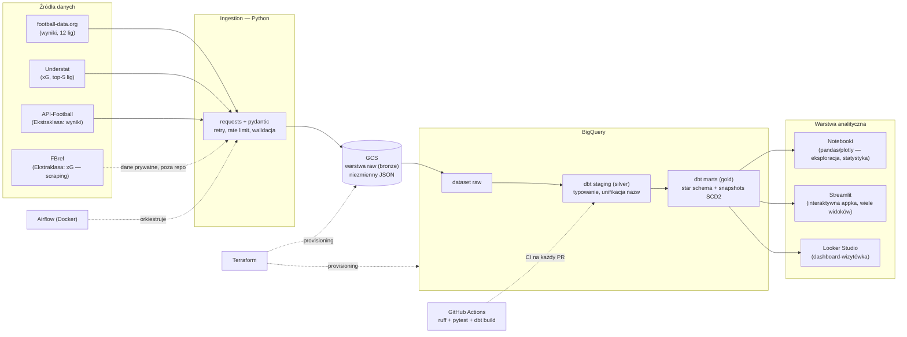

# Football Analytics Pipeline — plan projektu

> Dokument roboczy projektu portfolio z data engineeringu. Służy dwóm celom:
> **nauka** (każda faza ma sekcję „czego się uczysz") i **pokazanie umiejętności**
> rekruterom. Jest też źródłem prawdy dla agentów AI pracujących nad projektem —
> patrz sekcja [Instrukcje dla agentów](#instrukcje-dla-agentów).

**Status:** planowanie · **Autor:** Szymon · **Repo:** `~/my_projects/sport_analytics`
**Aktualizacja 2026-07-15:** rozszerzenie o wiele lig, skupienie na Ekstraklasie
oraz warstwę analityczną (notebooki + Streamlit) — projekt ma nie tylko pokazywać
warsztat rekruterowi, ale też realnie służyć autorowi do nauki statystyki i piłki.

---

## 1. Cel i teza projektu

Tygodniowy potok batch ELT, który pobiera wyniki meczów i statystyki zaawansowane
(xG) z publicznych źródeł **wielu europejskich lig**, ładuje je do hurtowni,
modeluje w gwiazdę i serwuje analizy odpowiadające na pytania: **które drużyny
i którzy zawodnicy przewyższają / zawodzą względem swojego xG i jak wypadają
w porównaniu między ligami?**

Projekt ma **dwóch odbiorców**: (1) rekrutera — demonstruje kompletny warsztat
data engineera; (2) autora — realne narzędzie do nauki statystyki i lepszego
rozumienia piłki, ze szczególnym **skupieniem na Ekstraklasie** (ulubiona liga),
z którego autor będzie korzystał na co dzień. Stąd rozbudowana warstwa analityczna
(notebooki + interaktywna aplikacja Streamlit), a nie pojedynczy dashboard.

Zakres danych (świadomie dobrany pod darmowe źródła — patrz sekcja 4):
**12 lig na wynikach** (football-data.org), **top-5 lig dodatkowo z xG** (Understat),
**Ekstraklasa** osobnymi ścieżkami (API-Football + odpowiedzialny scraping FBref).

Kluczowa decyzja architektoniczna pozostaje: **jeden silnik transformacji
(dbt + BigQuery), nie dwa**. Oryginalny pomysł (Spark + Delta Lake *oraz* dbt +
hurtownia równolegle) dublował compute i storage — w portfolio wygląda to na
niezrozumienie architektury. Spark wraca jako świadoma, **opcjonalna ostatnia faza**
na danych eventowych, gdzie ma choć trochę uzasadnienia.

## 2. Architektura



Wzorzec: **ELT** — surowe dane lądują w hurtowni niemal bez zmian, transformacje
robi SQL (dbt) już wewnątrz BigQuery. To dziś dominujący układ w ogłoszeniach
o pracę i pozwala trzymać całą logikę biznesową w jednym, testowalnym miejscu.

## 3. Stack technologiczny (z uzasadnieniami)

| Warstwa | Wybór | Dlaczego to, a nie alternatywa |
| :--- | :--- | :--- |
| Orkiestracja | **Apache Airflow 3** (docker-compose) | Najczęściej wymagany orkiestrator w ogłoszeniach. Prefect/Dagster są przyjemniejsze, ale rzadsze na rynku. |
| Ingestion | **Python** (requests + pydantic) | Pydantic waliduje odpowiedzi API na wejściu — zmiana schematu źródła wybucha głośno w ingestion, nie cicho w gold. |
| Data lake (raw) | **GCS** | Darmowe 5 GB (region US), natywna integracja z BigQuery. |
| Hurtownia | **BigQuery** | Sandbox darmowy bezterminowo (10 GB storage, 1 TB zapytań/mies.). Snowflake odpada: trial wygasa po 30 dniach, a projekt ma żyć miesiącami. |
| Transformacje + testy | **dbt Core** | Standard branżowy analytics engineeringu: modele SQL, testy jakości, dokumentacja lineage, snapshots SCD2. |
| IaC | **Terraform** | Bucket, datasety BQ, service account — realistyczny, mały zakres. |
| CI/CD | **GitHub Actions** | Lint + testy + `dbt build` na każdy PR. Największa pojedyncza rzecz odróżniająca projekt „firmowy" od tutorialowego. |
| Jakość kodu | **uv + ruff + pytest + pre-commit** | Współczesny standard tooling'u pythonowego. |
| Eksploracja + statystyka | **Jupyter + pandas + plotly** | Tu autor uczy się statystyki i „prototypuje" analizy przed wrzuceniem ich do aplikacji. |
| Aplikacja analityczna | **Streamlit** | Wiele konfigurowalnych widoków (filtry: liga / drużyna / zawodnik), pythonowa, darmowy hosting (Streamlit Community Cloud). Realizuje cel „będę z tego korzystał". |
| Dashboard-wizytówka | **Looker Studio** | Jeden dopracowany dashboard dla rekrutera; darmowe, natywne połączenie z BigQuery. |
| Scraping (Ekstraklasa xG) | **requests + selectolax/BeautifulSoup** | FBref jako **jedyne** darmowe źródło xG dla Ekstraklasy; kod publiczny, **dane nigdy do repo** (ToS Opty zabrania redystrybucji). Patrz sekcje 4 i 8. |
| (Opcja, ostatnia faza) | PySpark + Delta Lake | Tylko na danych eventowych StatsBomb i z jawnym dopiskiem w README, że to wybór edukacyjny. |

## 4. Źródła danych

Pokrycie i limity zweryfikowane 2026-07-15 — **to one dyktują zakres projektu**:

| Źródło | Dane | Pokrycie | Limit / ryzyko | Rola |
| :--- | :--- | :--- | :--- | :--- |
| **football-data.org** | wyniki, terminarz, tabele, składy | **12 lig free**: PL, La Liga, Bundesliga, Serie A, Ligue 1, Championship, Eredivisie, Primeira, Serie A (BR), LM, EURO, MŚ. **Bez Ekstraklasy.** | free: ~10 req/min | **Główne źródło meczów (wszystkie ligi)** |
| **Understat** | xG meczowe i per zawodnik (JSON w HTML) | **6 lig**: EPL, La Liga, Bundesliga, Serie A, Ligue 1, RFPL. **Bez Ekstraklasy.** | brak API; scraping lekki i stabilny | **Źródło xG dla top-5** + fuzzy matching |
| **API-Football** | wyniki, składy, staty drużynowe (**w tym Ekstraklasa**) | globalne, xG **niepewne** per liga/sezon | free: 100 req/dzień | **Źródło wyników Ekstraklasy** |
| **FBref** | zaawansowane staty **z xG dla Ekstraklasy** | Ekstraklasa tak | **10 req/min, bany IP do 24 h**, ToS zabrania redystrybucji (Opta); tabele w komentarzach HTML | **Jedyne darmowe xG Ekstraklasy** — scraping odpowiedzialny, dane **poza repo** (sekcja 8) |
| **StatsBomb Open Data** | pełne dane eventowe z xG (JSON na GitHubie) | wybrane rozgrywki | brak — darmowe i legalne | Opcjonalna ostatnia faza (Spark) |

**Twarde ograniczenie do zaakceptowania:** darmowego, redystrybuowalnego xG dla
Ekstraklasy praktycznie nie ma. Stąd asymetria świadomie wpisana w projekt:
**top-5 lig = analiza xG (over/underperformance), pozostałe 7 lig = analiza opisowa
(wyniki, forma, bramki), Ekstraklasa = wyniki (API-Football) + xG ze scrapingu FBref
do użytku prywatnego.** Ta asymetria i jej powód trafiają do README — to dojrzały
sygnał („rozumiem krajobraz danych"), nie wada.

Wyzwanie inżynieryjne z oryginalnego planu **zostaje i rośnie**: źródła inaczej
nazywają kluby i zawodników („Man Utd" vs „Manchester United"), a przy wielu ligach
kolizji nazw jest więcej. Rozwiązanie: `rapidfuzz` do wstępnego dopasowania + ręcznie
kuratorowana tabela mapowań jako **dbt seed** + test dbt, który failuje na niezmapowanej
nazwie.

## 5. Warstwy danych i konwencje

| Warstwa | Gdzie | Zawartość i zasady |
| :--- | :--- | :--- |
| **Bronze / raw** | GCS | Surowe odpowiedzi API, niezmienne (append-only). Ścieżka: `raw/source=<źródło>/competition=<liga>/season=<rrrr>/ingest_date=<rrrr-mm-dd>/<plik>.json`. Partycjonowanie po źródle, **lidze** i sezonie — przy 12 ligach płaska struktura samymi datami by się zemściła. **Dane FBref (Ekstraklasa) leżą w prywatnym prefiksie GCS / lokalnie i nigdy nie trafiają do gita** (sekcja 8). |
| **Silver / staging** | BigQuery, modele `stg_*` w dbt | Typowanie (`DATE`, `FLOAT64`), rozpakowanie zagnieżdżonego JSON-a, standaryzacja nazw przez seed mapowań. 1 model = 1 obiekt źródłowy. |
| **Gold / marts** | BigQuery, modele `dim_*` / `fct_*` w dbt | Star schema, modele inkrementalne ze strategią `merge` (to załatwia idempotentność), logika biznesowa. |

**Idempotentność i backfill** — zasada przekrojowa: każdy run jest parametryzowany
`data_interval` z Airflow (nie datą „dzisiejszą"!), pliki w raw są deterministycznie
nazwane per interwał, a zapis do gold idzie przez `MERGE`. Ponowne uruchomienie
tego samego okna daje identyczny stan — zero duplikatów. Backfill = `airflow dags
backfill` po starych interwałach, bez żadnego specjalnego kodu.

## 6. Model danych (star schema)

- `dim_competition` — liga/rozgrywki: klucz zastępczy, nazwa, kraj, poziom, czy
  ma pokrycie xG (flaga — od niej zależą widoki w warstwie analitycznej).
- `dim_teams` — klub: klucz zastępczy, nazwa kanoniczna, liga.
- `dim_players` — zawodnik, **SCD2 przez dbt snapshot**: historia przynależności
  klubowej (transfery!). To mocniejszy sygnał dla rekrutera niż cały Spark.
- `dim_date` — standardowy wymiar daty (sezon, kolejka, dzień tygodnia).
- `fct_matches` — grain: 1 mecz. Klucz do `dim_competition`, gole, xG obu stron
  (null tam, gdzie źródło nie ma xG), punkty.
- `fct_player_match_stats` — grain: zawodnik × mecz. Minuty, gole, asysty, xG, xA.
- seed `team_name_mapping.csv` (+ analogiczny dla zawodników).

**Testy dbt:** `unique` + `not_null` na kluczach, `relationships` fakty→wymiary,
testy własne (gole ≥ 0, xG ≥ 0, suma minut zawodników ≤ 11 × 90 + doliczony czas),
test na niezmapowane nazwy drużyn.

## 7. Fazy budowy

Najczęstszy błąd w takich projektach to szlifowanie warstwy bronze tygodniami.
Dlatego kolejność jest odwrotna: najpierw **cienki pion end-to-end**, potem
pogłębianie. Każda faza = osobna gałąź i PR z sensownym opisem — historia repo
sama w sobie jest częścią portfolio.

### Faza 0 — fundamenty repo
`git init`, struktura katalogów (sekcja 9), `uv init` + `pyproject.toml`, ruff,
pre-commit, `.env.example` (nigdy `.env` do repo), pierwsze README.
**Done gdy:** `pre-commit run --all-files` przechodzi na czystym klonie.
**Czego się uczysz:** higiena projektu pythonowego, jak wygląda repo „firmowe".

### Faza 1 — cienki pion (MVP, wszystko ręcznie)
**Jedna liga** (np. Premier League): jeden skrypt football-data.org → JSON na GCS →
`bq load` do datasetu raw → jeden model dbt (`stg_matches` + prosty `fct_matches`) →
jeden wykres w Looker Studio. Rozszerzenie na 12 lig przychodzi dopiero w fazie 4 —
najpierw ma działać cały przepływ na krzyż. Zasoby GCP na razie wyklikane ręcznie —
Terraform przyjdzie w fazie 8.
**Done gdy:** wykres w Looker Studio pokazuje dane prawdziwego meczu.
**Czego się uczysz:** cały przepływ ELT na krzyż, konsola GCP, podstawy dbt.
*Uwaga (gotcha):* w sandboksie BigQuery tabele domyślnie wygasają po 60 dniach —
docelowo podepnij konto rozliczeniowe (free tier 10 GB / 1 TB dalej obowiązuje).

### Faza 2 — ingestion na poważnie
Modele pydantic dla odpowiedzi API, retry z backoffem, logowanie strukturalne,
deterministyczne ścieżki zapisu per interwał, klient GCS. Testy pytest dla
parserów (fixture'y z prawdziwych odpowiedzi API zapisanych w `tests/fixtures/`).
**Done gdy:** pytest przechodzi; podwójne uruchomienie nie tworzy duplikatów w raw.
**Czego się uczysz:** kontrakty danych, defensywne pobieranie, testowanie I/O.

### Faza 3 — dbt na poważnie
Rozdzielenie staging/marts, modele inkrementalne (`merge`), pełny zestaw testów,
`dim_date`, `dbt docs generate` (screenshot lineage do README).
**Done gdy:** `dbt build` przechodzi w 100 % łącznie z testami.
**Czego się uczysz:** modelowanie wymiarowe, testy jakości danych, incremental
materializations — rdzeń pracy analytics engineera.

### Faza 4 — wiele lig, xG i fuzzy matching
Rozszerzenie ingestion o wszystkie 12 lig football-data.org (parametr `competition`,
jeden klient, pętla po ligach z rate limitem). Ingestion Understat (xG) dla top-5.
`dim_competition`, `rapidfuzz` do propozycji dopasowań, seed z mapowaniem, test dbt
failujący na niezmapowanych nazwach, `fct_player_match_stats`. xG jako pole nullowalne
(ligi bez pokrycia mają `NULL`, nie zero — to różnica analityczna, nie brak danych).
**Done gdy:** marty zawierają wyniki 12 lig i xG dla top-5; test niezmapowanych nazw
przechodzi na komplecie źródeł.
**Czego się uczysz:** integracja wielu niezgodnych źródeł i modelowanie różnego
pokrycia danych — najbardziej „prawdziwy" problem DE w całym projekcie.

### Faza 5 — Ekstraklasa (ulubiona liga)
Wyniki i staty Ekstraklasy z API-Football (klient z limitem 100 req/dzień). xG
z FBref przez **odpowiedzialny scraper**: rate limiter ≤10 req/min, User-Agent
z kontaktem, cache surowych odpowiedzi, parsowanie tabel z komentarzy HTML.
**Dane FBref nigdy nie trafiają do gita** — kod publiczny, dane w prywatnym prefiksie
GCS / lokalnie (`.gitignore`). Mapowanie nazw klubów Ekstraklasy do `dim_teams`.
**Done gdy:** Ekstraklasa jest w martach z wynikami (API-Football) i xG (FBref, lokalnie);
README wyjaśnia ograniczenia i legalność scrapingu.
**Czego się uczysz:** scraping produkcyjny (etykieta, rate limiting, cache), praca
z niepełnym/prawnie wrażliwym źródłem, świadome decyzje „co wolno opublikować".

### Faza 6 — warstwa analityczna (notebooki + Streamlit)
`notebooks/` (Jupyter + pandas + plotly): eksploracja i **nauka statystyki** —
over/underperformance vs xG, regresja do średniej, korelacje, porównania między
ligami, głęboki wgląd w Ekstraklasę. Sprawdzone analizy trafiają do aplikacji
**Streamlit** (`app/`) z wieloma widokami i filtrami (liga / drużyna / zawodnik /
sezon). Źródło danych: marty w BigQuery (opcjonalnie lokalny eksport do
parquet/DuckDB dla szybkich, darmowych zapytań interaktywnych).
**Done gdy:** aplikacja Streamlit startuje lokalnie i pokazuje ≥3 różne, filtrowalne
widoki; autor korzysta z niej do realnej analizy Ekstraklasy.
**Czego się uczysz:** statystyka piłkarska w praktyce, budowa aplikacji data, przejście
od notebooka-eksperymentu do narzędzia, z którego się faktycznie korzysta.

### Faza 7 — orkiestracja (Airflow)
Airflow 3 przez oficjalny docker-compose. DAG tygodniowy (wtorek rano — kolejka
rozciąga się od piątku do poniedziałku, więc „po kolejce" to śliski trigger):
ingestion (wszystkie ligi) → load → `dbt build`, parametryzowany `data_interval`,
`catchup` do backfillu historii sezonu, alert na Discorda (webhook w `on_failure_callback`).
**Done gdy:** `airflow dags backfill` odtwarza cały sezon bez duplikatów.
**Czego się uczysz:** DAG-i, harmonogramy, idempotentny backfill, alerting.

### Faza 8 — Terraform i CI/CD
Terraform: bucket GCS, datasety BQ, service account z minimalnymi uprawnieniami —
import zasobów wyklikanych w fazie 1 (`terraform import`). GitHub Actions: ruff +
pytest + `dbt build --target ci` na osobnym datasecie dev przy każdym PR.
**Done gdy:** `terraform apply` na czystym projekcie GCP stawia całość; CI blokuje
PR z failującym testem.
**Czego się uczysz:** IaC, separacja środowisk dev/prod, sekrety w GitHub Actions.

### Faza 9 — SCD2, dashboard-wizytówka, dokumentacja
Snapshot dbt na `dim_players` (historia transferów), dopracowany dashboard w Looker
Studio (tabela xG vs punkty, over/underperformerzy, porównanie lig), README
z diagramem architektury, instrukcją `docker-compose up` i sekcją „decyzje
architektoniczne i ich powody".
**Done gdy:** osoba z zewnątrz stawia projekt lokalnie z samego README.
**Czego się uczysz:** SCD2 w praktyce, komunikowanie projektu — to czyta rekruter.

### Faza 10 (opcjonalna) — Spark na danych eventowych
PySpark w Dockerze przetwarza dane eventowe StatsBomb (JSON, miliony wierszy —
jedyne dane w projekcie, gdzie Spark nie jest armatą na muchę) do agregatów
per zawodnik, zapis w Delta Lake na GCS, zewnętrzna tabela w BigQuery.
**Czego się uczysz:** API Sparka, format Delta — pod ogłoszenia „big data".

## 8. Zasady przekrojowe

- **Sekrety:** wyłącznie zmienne środowiskowe / Airflow Connections / GitHub
  Secrets. Klucz API w historii gita = projekt do kosza w oczach rekrutera.
- **Koszty:** cały projekt mieści się w free tier (BigQuery 10 GB / 1 TB zapytań
  mies., GCS 5 GB w regionie US, Looker Studio i GitHub Actions darmowe, Airflow
  lokalnie). Trzymaj region `us-central1` dla free tier GCS.
- **Szacunek do źródeł:** limity requestów zakodowane w klientach (rate limiter,
  szczególnie FBref ≤10 req/min), User-Agent z kontaktem, cache surowych odpowiedzi
  w raw — nigdy nie pobieraj drugi raz czegoś, co już masz.
- **Legalność i redystrybucja:** kod scraperów jest publiczny, ale **surowe dane
  FBref (Opta) nigdy nie trafiają do repo** — ToS zabrania redystrybucji. Trzymaj je
  w prywatnym prefiksie GCS / lokalnie i w `.gitignore`. To świadoma linia: pokazujemy
  *jak* scrapować odpowiedzialnie, nie publikujemy cudzych danych.
- **Wolumen:** 12 lig na wynikach + top-5 na xG + Ekstraklasa dalej mieści się
  w free tier (dane meczowe są małe — to megabajty, nie gigabajty).
- **Konwencja commitów:** Conventional Commits (`feat:`, `fix:`, `chore:`) —
  czytelna historia to też portfolio.

## 9. Struktura repo (docelowa)

```
sport_analytics/
├── plan.md                  # ten dokument
├── README.md
├── pyproject.toml           # uv, ruff, pytest
├── .pre-commit-config.yaml
├── .env.example
├── docker-compose.yml       # Airflow (faza 7)
├── ingestion/
│   ├── sources/             # football_data.py, understat.py, api_football.py, fbref.py
│   ├── models.py            # modele pydantic
│   └── gcs.py
├── dags/
│   └── weekly_pipeline.py
├── dbt/
│   ├── models/staging/
│   ├── models/marts/        # dim_competition, dim_teams, fct_matches, ...
│   ├── seeds/               # team_name_mapping.csv
│   ├── snapshots/
│   └── tests/
├── notebooks/               # eksploracja + nauka statystyki (faza 6)
├── app/                     # aplikacja Streamlit (faza 6)
│   └── streamlit_app.py
├── terraform/
├── tests/                   # pytest + fixtures/
├── data/                    # lokalny cache/eksport — w .gitignore (m.in. dane FBref)
└── .github/workflows/ci.yml
```

## 10. Czego dowie się przeglądający (checklista)

- [ ] ELT z medallion architecture i świadomym wyborem jednego silnika transformacji
- [ ] idempotentny, backfillowalny potok (data_interval + MERGE)
- [ ] integracja **wielu źródeł i wielu lig** o różnym pokryciu danych (xG vs opisowe)
- [ ] testy na trzech poziomach: pytest (kod), pydantic (kontrakt wejścia), dbt (dane)
- [ ] CI/CD blokujące wadliwe PR-y
- [ ] IaC — środowisko odtwarzalne jednym `terraform apply`
- [ ] SCD2 na realnym przypadku (transfery zawodników)
- [ ] integracja niezgodnych źródeł (fuzzy matching + seed + test)
- [ ] **odpowiedzialny scraping** (rate limit, cache; kod publiczny, dane prywatne)
- [ ] **warstwa analityczna**: notebooki (statystyka) + interaktywna aplikacja Streamlit
- [ ] dokumentacja: README z diagramem, dbt docs, sekcja decyzji architektonicznych

## Instrukcje dla agentów

1. Pracujemy fazami z sekcji 7, **w kolejności** — nie zaczynaj fazy N+1, dopóki
   kryterium „Done gdy" fazy N nie jest spełnione.
2. Nie dokładaj technologii spoza sekcji 3 bez uzgodnienia z Szymonem.
3. Wszystko musi mieścić się w darmowych tierach (sekcja 8) — żadnych zasobów
   GCP generujących koszty bez wyraźnej zgody.
4. Szanuj limity źródeł: football-data.org ~10 req/min, API-Football 100 req/dzień;
   FBref nie scrapujemy.
5. Sekrety nigdy w kodzie ani w repo; wzorce do `.env.example`.
6. Projekt jest edukacyjny: przy nietrywialnych decyzjach dopisuj krótkie „dlaczego"
   (w PR, README lub komentarzu), zamiast tylko dostarczać kod.
7. Komunikacja z Szymonem po polsku.
